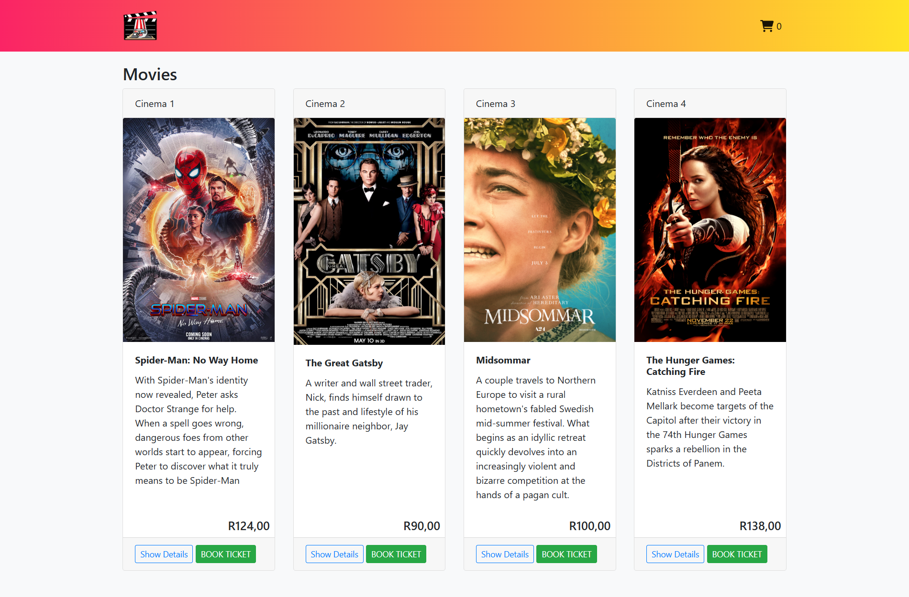
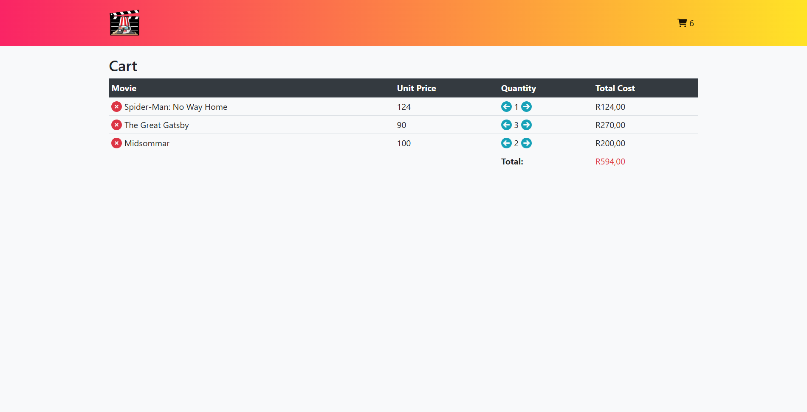

# Movie Ticket Booking Website

A front-end web application for browsing movies and booking cinema tickets. Users can view the available movies, read details about each one, add tickets to a shopping cart, and manage their cart before checkout. The cart persists between page loads and browser sessions.

- **Author:** Tifuh Nche
- **Course:** INF 272 - Advanced Programming
- **Institution:** University of Pretoria
- **Year:** 2022

---

## Overview

This project was built as a practical assignment for the course listed above. It simulates the front end of an online cinema booking system, with no back end: all data lives in a JavaScript array and the shopping cart is kept in the browser's `localStorage`.

The goal of the assignment was to practise building a multi-page, responsive website using HTML, CSS, Bootstrap, and JavaScript/jQuery, including dynamic DOM generation and client-side state management.

## Features

### Home page (`home.html`)
- Movie cards generated dynamically from an array of movie objects (title, poster, description, cinema number, ticket price in Rands)
- **Show Details** button opens a Bootstrap modal with the title, director(s), release year, and runtime
- **Book Ticket** button adds a ticket to the cart
- Cart icon in the navigation bar shows the live number of tickets in the cart



### Cart page (`cart.html`)
- Table listing each movie in the cart with unit price, quantity, and line total
- Increase or decrease the quantity of tickets using arrow icons
- Remove a movie from the cart entirely
- Running total cost for the whole cart
- "No Movies In your Cart" message when the cart is empty



### Persistence
- Cart contents, ticket count, and total cost are stored in `localStorage`, so the cart survives page reloads and navigation between pages

## Technologies Used

- **HTML5**
- **CSS3** (custom styles plus a gradient navigation bar)
- **Bootstrap 4** (grid, cards, modal, navbar, tables)
- **JavaScript (ES6)** (spread operator, template literals, arrow functions)
- **jQuery 3.5.1** (event handling)
- **Font Awesome 6.1** (icons)
- **Web Storage API** (`localStorage`)

## Project Structure

```
.
├── home.html        # Movie listing page
├── cart.html        # Shopping cart page
├── script.js        # Movie data, home page logic, and cart logic
├── style.css        # Custom styles
├── README.md
├── css/
│   ├── bootstrap.css
│   └── main.css
├── js/
│   └── bootstrap.js
└── images/
    ├── logo.png
    ├── SpiderManNWH.jpg
    ├── GreatGatsby.jpg
    ├── Midsommar.jpg
    └── HungerGamesCF.jpg
```

> Note: the `css/`, `js/`, and `images/` folders hold the Bootstrap files and image assets referenced by the HTML pages.

## How to Run

1. Download or clone the repository.
2. Open `home.html` in any modern web browser.
3. Click **Book Ticket** on a movie, then click the cart icon in the navigation bar to view and edit your cart.

No build step or server is required. An internet connection is needed for jQuery and Font Awesome, which are loaded from a CDN.

## How It Works

- `script.js` defines the `movies` array, which acts as the data source for the site.
- On the home page, `window.onload` builds the movie cards from that array and attaches the click handlers for the details and booking buttons.
- Booking a ticket updates three values in `localStorage`: `moviesInCart` (the cart items), `numberInCart` (the total ticket count), and `totalCost`.
- The cart page reads those values and renders the table. The quantity and delete controls update `localStorage` and re-render the cart.

## Possible Improvements

- Add a checkout flow and booking confirmation
- Add showtime and seat selection
- Move movie data to a back end or API
- Compute the cart total from the items instead of storing it separately
